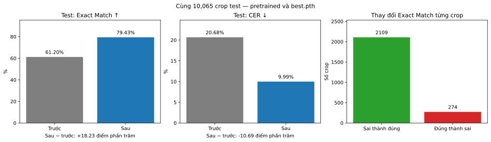
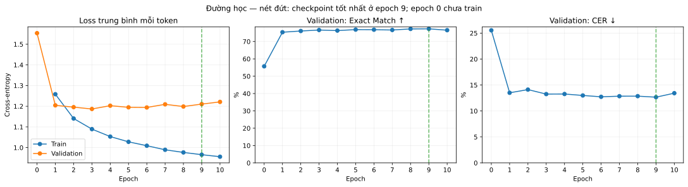

# VietOCR × VinText

Benchmark và full fine-tuning mô hình nhận dạng chữ tiếng Việt **VietOCR `vgg_seq2seq`** trên VinText. Quy trình gồm chuẩn bị crop, đo pretrained, huấn luyện theo epoch, đánh giá lại trên cùng test và phân tích từng dự đoán.

**Model:** `vgg_seq2seq` · **Phương pháp:** Full fine-tuning · **Thiết bị:** CPU · **Checkpoint tốt nhất:** Epoch 9/10

> Trên **10.065 crop test**, Exact Match tăng từ **61,20% → 79,43%**, CER giảm từ **20,68% → 9,99%**. Checkpoint được chọn bằng validation trước khi đánh giá test.

## 1. Kết quả benchmark

Hai lần đo sử dụng cùng danh sách test, đáp án và cấu hình suy luận: **CPU, 4 thread, batch 1, greedy decoding, 3 lượt warmup**. SHA-256 của danh sách test và thông tin môi trường trước/sau trùng nhau.

| Chỉ số trên test | Pretrained | Sau fine-tuning | Thay đổi |
| :--- | ---: | ---: | ---: |
| Số crop | 10.065 | 10.065 | Giữ nguyên |
| Chuỗi đúng hoàn toàn | 6.160 | 7.995 | +1.835 |
| Chuỗi sai | 3.905 | 2.070 | −1.835 |
| **Exact Match ↑** | **61,20%** | **79,43%** | **+18,23 điểm phần trăm** |
| **CER ↓** | **20,68%** | **9,99%** | **−10,69 điểm phần trăm** |
| Tổng phép sửa ký tự | 7.702 | 3.720 | −3.982 |
| Mean latency | 40,57 ms | 39,84 ms | −0,73 ms |
| Median latency | 36,70 ms | 36,21 ms | −0,48 ms |
| P95 latency | 76,00 ms | 72,70 ms | −3,30 ms |

CER giảm **51,70% tương đối**; số crop sai giảm **46,99%**. Đây là tỷ lệ giảm so với pretrained, khác với mức thay đổi tính bằng điểm phần trăm trong bảng.



### Thay đổi trên từng crop

| Kết quả ghép cặp trước/sau | Số crop |
| :--- | ---: |
| Sai thành đúng | 2.109 |
| Đúng thành sai | 274 |
| Vẫn sai, ít phép sửa hơn | 694 |
| Vẫn sai, nhiều phép sửa hơn | 201 |
| Bằng số phép sửa | 6.787 |

Model sửa đúng 2.109 crop nhưng làm sai thêm 274 crop từng đọc đúng: mức tăng ròng là **1.835 crop**. Nhóm “bằng số phép sửa” gồm cả mẫu vẫn đúng và mẫu vẫn sai; không có nghĩa dự đoán trước/sau giống nhau.

Nguồn: [benchmark trước](output/benchmark/before/metrics.json), [benchmark sau](output/benchmark/after/metrics.json), [báo cáo so sánh](output/analysis/after/report.md) và [dự đoán ghép cặp](output/analysis/after/paired_changes.csv).

### Những lỗi còn lại

| Nhóm sai khác chuỗi | Trước | Sau |
| :--- | ---: | ---: |
| Khác nội dung/khoảng trắng | 2.453 | 1.392 |
| Chỉ khác dấu/đ | 1.231 | 523 |
| Chỉ khác hoa/thường | 161 | 129 |
| Khác dấu và hoa/thường | 60 | 25 |
| Dự đoán rỗng | 0 | 1 |
| **Tổng mẫu sai** | **3.905** | **2.070** |

Lỗi nội dung/khoảng trắng vẫn nhiều nhất. Sai dấu/đ giảm rõ nhưng còn 523 crop. Đây là phân nhóm theo văn bản, chưa chứng minh nguyên nhân nằm ở chất lượng ảnh, crop hay mô hình; cần mở ảnh tương ứng trong [bảng lỗi sau fine-tuning](output/analysis/after/errors.csv) để kiểm tra.

| Độ dài đáp án | Số crop | Exact Match trước → sau | CER trước → sau |
| :--- | ---: | ---: | ---: |
| 1 ký tự | 559 | 55,64% → 77,82% | 52,42% → 28,98% |
| 2–3 ký tự | 4.760 | 60,80% → 80,84% | 23,20% → 11,26% |
| 4–6 ký tự | 4.181 | 64,31% → 80,36% | 17,94% → 8,17% |
| 7+ ký tự | 565 | 47,08% → 62,30% | 21,01% → 11,38% |

Cả bốn nhóm đều cải thiện. Nhóm **7+ ký tự** vẫn có Exact Match thấp nhất; nhóm **1 ký tự** có CER cao nhất. Hướng kiểm tra tiếp theo là xem crop dài, các mẫu mất dấu và 274 mẫu bị làm sai thêm; thử nghiệm cải tiến cần được chọn bằng validation, không tối ưu trực tiếp theo test.

Nguồn: [nhóm lỗi trước](output/analysis/before/metrics.json), [nhóm lỗi sau](output/analysis/after/metrics.json), [độ dài trước](output/analysis/before/by_length.csv), [độ dài sau](output/analysis/after/by_length.csv).

## 2. Quá trình huấn luyện

Full fine-tuning cập nhật **toàn bộ tham số** của pretrained đã benchmark. Mỗi epoch duyệt hết train, sau đó đánh giá hết validation. **Epoch 0 chỉ đo pretrained trên validation**, chưa cập nhật trọng số.

| Epoch | Train loss | Val loss | Exact Match validation | CER validation |
| :--- | ---: | ---: | ---: | ---: |
| 0 — pretrained | — | 1,5535 | 55,71% | 25,54% |
| 1 | 1,2582 | 1,2044 | 75,37% | 13,51% |
| 3 — val loss thấp nhất | 1,0894 | 1,1868 | 76,64% | 13,26% |
| **9 — best.pth** | **0,9657** | **1,2104** | **77,32%** | **12,66%** |
| 10 — last.pth | 0,9559 | 1,2210 | 76,54% | 13,43% |



Model cải thiện mạnh ngay epoch đầu, sau đó tăng chậm và dao động. Epoch 9 có Exact Match validation cao nhất; epoch 10 tiếp tục giảm train loss nhưng val loss tăng và điểm chuỗi giảm, cho thấy dấu hiệu overfitting ở cuối quá trình.

**Quy tắc chọn checkpoint:** Exact Match validation cao nhất; nếu bằng nhau, chọn CER thấp hơn. Vì vậy chọn **epoch 9**, dù val loss thấp nhất ở epoch 3. Điểm validation và điểm test được báo riêng; không lấy hiệu giữa hai tập để tính mức cải thiện.

Nguồn: [toàn bộ lịch sử epoch](output/finetuning/history.csv), [best metrics](output/finetuning/best_metrics.json), [cấu hình lần train](output/finetuning/run.json), [tổng kết hoàn tất](output/finetuning/summary.json).

## 3. Dữ liệu và tiền xử lý

Nguồn sử dụng: `vintext_original/vietnamese`. Chia theo **ảnh nguồn**, không chia ngẫu nhiên các crop từ cùng ảnh.

| Tập | Thư mục gốc | Mã ảnh | Ảnh nguồn | Crop giữ lại | Vùng bị loại |
| :--- | :--- | :--- | ---: | ---: | ---: |
| Train | `train_images` | 1–1200 | 1.200 | 25.723 | 9.371 |
| Validation | `test_image` | 1201–1500 | 300 | 7.191 | 1.546 |
| Test | `unseen_test_images` | 1501–2000 | 500 | 10.065 | 2.188 |

Trong thí nghiệm này, `test_image` được dùng làm **validation**; `unseen_test_images` là **test giữ riêng**. Tập test không tham gia cập nhật trọng số hoặc chọn checkpoint.

Tiền xử lý cắt vùng chữ theo tứ giác nhãn và chỉnh phối cảnh, không tự thêm padding hay bước xoay bổ sung. Văn bản được chuẩn hóa Unicode NFC, giữ nguyên dấu, hoa/thường và khoảng trắng.

- Mọi tập loại nhãn `###`, nhãn rỗng và tứ giác không hợp lệ.
- Train/validation loại thêm nhãn ngoài vocab hoặc dài hơn giới hạn giải mã. Test vẫn giữ các nhãn này để chấm trung thực.
- Từng vùng bị loại có lý do trong `excluded.csv`; tổng số ghi tại `preparation.json`.
- Train/validation/test được kiểm tra không trùng ảnh nguồn. So sánh trước/sau kiểm tra cùng định danh, đáp án và SHA-256 crop.

Thống kê gốc: [train](output/crops/train/preparation.json) · [validation](output/crops/val/preparation.json) · [test](output/crops/test/preparation.json).

## 4. Chỉ số và cách đo

| Chỉ số | Công thức / cách đo | Ý nghĩa |
| :--- | :--- | :--- |
| **Exact Match ↑** | Số chuỗi đúng hoàn toàn / tổng số crop | Tỷ lệ nhận dạng đúng nguyên chuỗi, phân biệt dấu, hoa/thường và khoảng trắng. |
| **CER ↓** | Tổng khoảng cách Levenshtein / tổng ký tự đáp án | Lượng lỗi thêm, xóa, thay ký tự trên toàn tập; không lấy trung bình CER từng crop. |
| **Mean / median / P95 ↓** | Trung bình / trung vị / phần tử hạng `ceil(0,95 × N)` của latency | Chi phí trung bình, thời gian điển hình và phần đuôi chậm. Đơn vị ms/crop. |
| **Train / val loss ↓** | Cross-entropy có label smoothing, chia cho số token khác PAD, gồm EOS | Theo dõi quá trình học và khoảng cách train/validation; không thay thế điểm giải mã. |
| **Thay đổi từng crop** | Ghép cặp hai dự đoán trên cùng mẫu | Phát hiện cả mẫu được sửa và mẫu bị làm sai thêm. |

Test có **37.246 ký tự đáp án** ở cả hai lần đo. CER có thể vượt 100% nếu dự đoán chèn nhiều ký tự. Mức tăng Exact Match được báo bằng **điểm phần trăm**; tỷ lệ giảm tương đối được ghi riêng.

Latency chỉ đo **tiền xử lý đầu vào model → suy luận → giải mã**, không gồm đọc file ảnh, tính hash, tải model, crop hoặc warmup. Kết quả CPU trước/sau được đo cùng môi trường; chênh lệch nhỏ chưa đủ khẳng định tăng tốc khi chưa đo lặp nhiều lần.

**Phạm vi đánh giá:** nhận dạng chữ từ crop theo nhãn gốc, chưa đo phát hiện chữ hoặc OCR đầu cuối. Chưa xác minh pretrained có từng tiếp xúc dữ liệu test này trong quá trình huấn luyện ban đầu. Kết quả mô tả một lần fine-tuning, chưa đo độ biến thiên qua nhiều seed.

## 5. Cấu trúc dự án

```text
OCRreg/
├── config.py               # Tham số và đường dẫn dùng chung
├── utils.py                # Đọc/ghi, hash và xử lý lỗi tiếng Việt
├── preprocessing/
│   └── data.py             # Đọc nhãn, crop và chuẩn bị các tập
├── benchmark/
│   └── run.py              # Suy luận trên toàn bộ test trước/sau
├── analysis/
│   ├── metrics.py          # Công thức chỉ số, nhóm lỗi, chọn best
│   ├── report.py           # Báo cáo và so sánh từng dự đoán
│   └── plots.py            # Biểu đồ quá trình train và benchmark
├── finetuning/
│   ├── dataset.py          # Dataset, resize và batch cùng chiều rộng
│   └── train.py            # Full fine-tuning theo epoch
├── tests/                  # Kiểm tra metrics, crop và batch
├── output/                 # Crop, dự đoán, báo cáo và checkpoint
├── requirements.txt        # Dependencies Python
├── .gitignore              # Bỏ qua môi trường và dữ liệu gốc
└── .gitattributes           # Git LFS cho ảnh/trọng số trong output
```

Các file `__init__.py` đánh dấu package. Toàn bộ tham số chỉnh tại [config.py](config.py), không cần sửa từng script.

| Đầu ra | Nội dung |
| :--- | :--- |
| `output/crops/{train,val,test}/` | `images/`, `samples.csv`, `excluded.csv`, `preparation.json` |
| `output/benchmark/{before,after}/` | `predictions.csv`, `metrics.json`, `model.yml`, `weights.pth` |
| `output/analysis/{before,after}/` | `report.md`, `errors.csv`, `by_length.csv`, `metrics.json` |
| `output/analysis/after/paired_changes.csv` | Dự đoán trước/sau và trạng thái thay đổi của từng crop |
| `output/analysis/training/` | `learning_curves.png` và `.svg` |
| `output/analysis/after/test_comparison.*` | Biểu đồ test dạng PNG và SVG |
| `output/finetuning/` | `best.pth`, `last.pth`, `model.yml`, `history.csv`, `best_metrics.json`, `run.json`, `summary.json` |
| `output/logs/errors.log` | Chi tiết kỹ thuật khi có lỗi |

Đường dẫn crop trong CSV được tính tương đối từ thư mục chứa CSV. `best.pth` dùng để đánh giá test; `last.pth` là trọng số ở epoch cuối. Checkpoint chưa lưu optimizer để tiếp tục chính xác một phiên train bị ngắt.

## 6. Môi trường và cấu hình

Môi trường đã dùng: **Windows · Python 3.11.9 · PyTorch 2.15.0+cpu · torchvision 0.29.2+cpu · VietOCR 0.3.13**. Phiên bản thực tế của các thư viện được lưu trong JSON benchmark và `run.json`; `requirements.txt` chưa khóa toàn bộ phiên bản.

### Cài đặt trên máy mới

```powershell
git lfs install
git clone https://github.com/NguyenThHien/OCRreg.git
Set-Location OCRreg
git lfs pull

py -3.11 -m venv .venv
.\.venv\Scripts\python.exe -m pip install -r requirements.txt
```

Repository chứa code và `output`; dữ liệu gốc cần chuẩn bị riêng để chạy lại tiền xử lý. Đặt `labels`, `train_images`, `test_image`, `unseen_test_images` trong `vintext_original/vietnamese`, hoặc sửa `SOURCE` tại `config.py`.

### Tham số thí nghiệm

| Tham số | Giá trị | Mục đích |
| :--- | :--- | :--- |
| `MODEL_NAME` | `vgg_seq2seq` | Cấu hình pretrained VietOCR. |
| `IMAGE_HEIGHT` | 32 px | Chiều cao sau resize. |
| `IMAGE_MIN_WIDTH` / `IMAGE_MAX_WIDTH` | 32 / 512 px | Giới hạn chiều rộng đầu vào. |
| `MAX_TEXT_LENGTH` | 128 | Giới hạn giải mã greedy. |
| `EPOCHS` / `BATCH_SIZE` | 10 / 4 | Train toàn bộ tập mỗi epoch; giữ cả batch thiếu. |
| `LEARNING_RATE` | 0,0001 | Learning rate cố định của AdamW. |
| `WEIGHT_DECAY` | 0,01 | Điều chuẩn trọng số. |
| `LABEL_SMOOTHING` | 0,1 | Làm mềm nhãn trong cross-entropy. |
| `GRADIENT_CLIP` | 1,0 | Giới hạn chuẩn gradient. |
| `TRAIN_DEVICE` / `BENCHMARK_DEVICE` | `cpu` / `cpu` | Thiết bị huấn luyện và đánh giá. |
| `CPU_THREADS` / `WARMUP_RUNS` | 4 / 3 | Số thread dùng chung; warmup chỉ áp dụng benchmark. |
| `SEED` | 42 | Khởi tạo ngẫu nhiên và xáo trộn batch train. |

Kích thước và trọng số model thực dùng được lưu trong `model.yml`. Train khởi tạo từ đúng pretrained đã benchmark, kiểm tra bằng SHA-256.

## 7. Chạy từng bước

**Đọc kết quả hiện có:** mở các báo cáo và biểu đồ ở trên, không cần train lại. Có thể chạy lại `analysis.report` và `analysis.plots` từ CSV đã lưu.

**Tạo thí nghiệm mới:** chuẩn bị dữ liệu gốc; nếu đã có kết quả, đổi `OUTPUT` trong `config.py` sang thư mục mới trước khi chạy toàn bộ quy trình. Các bước tạo crop, benchmark và train từ chối ghi đè thư mục kết quả đã có.

Chạy lần lượt từ thư mục gốc dự án, chỉ đi tiếp khi bước trước thành công:

```powershell
# 0. Kiểm tra logic bằng dữ liệu nhỏ, không train model.
.\.venv\Scripts\python.exe -m unittest discover -s tests -p "test_*.py" -v

# 1. Chuẩn bị test một lần và giữ cố định.
.\.venv\Scripts\python.exe -m preprocessing.data test

# 2. Benchmark và phân tích pretrained trên toàn bộ test.
.\.venv\Scripts\python.exe -m benchmark.run before
.\.venv\Scripts\python.exe -m analysis.report before

# 3. Chuẩn bị train/validation rồi full fine-tuning.
.\.venv\Scripts\python.exe -m preprocessing.data train
.\.venv\Scripts\python.exe -m finetuning.train

# 4. Benchmark best.pth trên chính test ở bước 1.
.\.venv\Scripts\python.exe -m benchmark.run after
.\.venv\Scripts\python.exe -m analysis.report after

# 5. Vẽ biểu đồ từ kết quả đã lưu, không chạy lại model.
.\.venv\Scripts\python.exe -m analysis.plots training
.\.venv\Scripts\python.exe -m analysis.plots test
```

Pipeline hiện tại đã hoàn tất chuẩn bị dữ liệu, benchmark trước, train 10 epoch, benchmark sau, phân tích và tạo hai biểu đồ. Log kiểm tra được cung cấp xác nhận **9 test thành công trước khi bổ sung mã vẽ biểu đồ**; không coi đó là kiểm thử tự động cho phần vẽ.

## 8. Lưu code và kết quả trên GitHub

`.gitignore` giữ môi trường ảo, cache Python, dữ liệu gốc và cấu hình riêng của máy ngoài Git. Toàn bộ `output` được đưa lên repository; `.gitattributes` cấu hình Git LFS cho ảnh PNG và trọng số. CSV, JSON, YAML, Markdown và SVG được lưu bằng Git thông thường.

Cập nhật tài liệu và kết quả vào repository đã có remote:

```powershell
git lfs install --local
git add README.md .gitignore .gitattributes
git add output
git diff --cached --stat --stat-count=15
git commit -m "Cập nhật tài liệu và kết quả VietOCR trên VinText"
git push origin main
```

Git LFS lưu nội dung ảnh/trọng số riêng và tải chúng khi clone/pull. Xem [Git LFS](https://git-lfs.com/) và [cách tính dung lượng, băng thông trên GitHub](https://docs.github.com/en/billing/concepts/product-billing/git-lfs).
